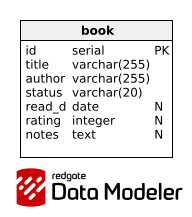

# Registro de Libros Leídos

Trabajo de cursada — Programación Web.
Aplicación web para llevar un registro personal de libros leídos.

**Entrega TP3 — Exponiendo la Lógica como API.** Esta entrega expone la capa
de datos de la entrega anterior a través de una API REST en JSON, organizada
en capas según la separación de responsabilidades de la cátedra
(handler → servicio → repositorio). La base y la API corren en contenedores, y
cada endpoint se prueba con Hurl.

## Requisitos

| Herramienta | Versión mínima | Por qué |
|---|---|---|
| Go | 1.26.5 | Es la versión declarada en el módulo; compila y corre los tests de las reglas |
| sqlc | 1.31.1 | Genera el código de acceso a datos (`sqlc.yaml` usa `version: "2"`) |
| Docker Engine | 29.7.2 | Levanta PostgreSQL y la API, y corre Hurl desde su imagen |
| Docker Compose | **v2** 5.5.0 | El flujo usa `docker compose up --wait`, que no existe en el binario v1 `docker-compose` |
| make | — | Automatiza las tareas |

**No hace falta instalar PostgreSQL ni Hurl**: corren desde imágenes de
Docker con la versión fija (PostgreSQL 16, Hurl 7.1.0).

**Los puertos 5432 (base) y 8080 (API) tienen que estar libres.**

## Cómo probar el proyecto

Después de clonar, desde la raíz del proyecto:

    make test-api

Ese comando realiza el ciclo completo, en este orden:

**Tareas previas**

1. Genera el código de acceso a datos con `sqlc generate`.
2. Compila el proyecto.
3. Elimina contenedores y volúmenes de corridas previas.
4. Construye la imagen de la API, levanta PostgreSQL y la API, y espera a que
   los dos `healthcheck` las den por sanas.

**Prueba de los endpoints**

5. Prueba cada endpoint con las 34 peticiones de `requests.hurl`, contra la
   API del contenedor.

**Tareas posteriores**

6. Elimina contenedores y volúmenes, **aunque la prueba haya fallado**. En ese
   caso el comando termina con error.

Hay que ejecutarlo **desde la raíz del proyecto**: las rutas del
`docker-compose.yml` son relativas a la ubicación de ese archivo.

**La primera vez**, antes del paso 1, `make` crea el archivo `.env` copiando
`.env.example` (el `.env` no se versiona; ver "Credenciales" más abajo).
También tarda más: Docker descarga las imágenes y PostgreSQL inicializa la
base.

### Tests de las reglas del negocio

    make test

Corre `logic/service_test.go`: las reglas de alta, las transiciones de estado,
el puntaje, las notas, la fecha de lectura y los casos de concurrencia. Usan un
repositorio falso en memoria, así que no necesitan la base ni Docker.

## Cómo ejecutar la API

**Todo en contenedores:**

    make up         # genera, construye y levanta la base y la API
    make requests   # corre requests.hurl contra la API levantada
    make logs       # muestra el log de la API
    make down       # elimina contenedores y volúmenes

**Para desarrollar**, con la base en un contenedor y la API corriendo con Go:

    make run        # levanta la base y arranca la API en http://localhost:8080

`Ctrl+C` corta el servidor; la base sigue levantada hasta `make down`. No usar
`make up` y `make run` a la vez: ocupan el mismo puerto.

**Atención:** `make down` y `make test-api` borran el volumen de la base, es
decir, todos los libros cargados.

### Otras tareas

    make generate   # genera el código de acceso a datos con sqlc
    make build      # compila (genera primero)
    make test       # tests de las reglas del negocio (sin base)
    make clean      # elimina el entorno y el código generado

Sin `make` (por ejemplo, con `docker compose up` directo) hay que hacer a mano,
desde la raíz del proyecto, lo que `make` hace antes: crear el `.env`
(`cp .env.example .env`) y generar el código (`sqlc generate`). Sin el `.env`,
Compose deja vacías las credenciales y PostgreSQL no arranca; sin `db/sqlc`, la
imagen de la API no compila.

## Endpoints

| Método y ruta | Cuerpo | Respuesta |
|---|---|---|
| `GET /books` | — | 200 con la lista ordenada por título (`[]` si no hay libros) |
| `POST /books` | `{"title": "...", "author": "..."}` | 201 con el libro creado (estado `no_leido`), o 400 |
| `GET /books/{id}` | — | 200 con el libro, o 404 |
| `PUT /books/{id}` | `{"status": "...", "rating": 1-5, "notes": "..."}` | 200 con el libro actualizado, o 400 / 404 / 409 |
| `DELETE /books/{id}` | — | 204 sin cuerpo, o 404 |

Un libro se devuelve así:

    {
      "id": 1,
      "title": "Rayuela",
      "author": "Julio Cortázar",
      "status": "leido",
      "read_date": "2026-10-10",
      "rating": 5,
      "notes": "Muy bueno"
    }

Todas las respuestas son JSON, también las de error: `{"error": "libro no encontrado"}`.

| Código | Cuándo |
|---|---|
| 400 | El cuerpo no es el JSON esperado, trae un campo que no es del contrato, el id no es un número, o los datos no cumplen una regla |
| 404 | El libro no existe, o la ruta no es de la API |
| 405 | El método no corresponde a la ruta (con la cabecera `Allow`) |
| 409 | El cambio de estado no está permitido, u otra petición modificó el libro al mismo tiempo |
| 500 | Error interno: el detalle va al log, al cliente solo un mensaje genérico |

Ejemplos con curl (con la API levantada):

    curl -i http://localhost:8080/books
    curl -i -X POST http://localhost:8080/books -d '{"title": "Rayuela", "author": "Julio Cortázar"}'
    curl -i http://localhost:8080/books/1
    curl -i -X PUT http://localhost:8080/books/1 -d '{"status": "leyendo"}'
    curl -i -X PUT http://localhost:8080/books/1 -d '{"status": "leido", "rating": 5, "notes": "Muy bueno"}'
    curl -i -X DELETE http://localhost:8080/books/1

`requests.hurl` tiene todas las peticiones probadas, con lo que se espera de
cada una.

## Reglas del dominio

- Título y autor son obligatorios: se guardan sin los espacios de los bordes,
  no pueden quedar vacíos y tienen como máximo 255 caracteres.
- Todo libro nuevo empieza en `no_leido`; el estado lo pone el sistema.
- Transiciones permitidas: `no_leido → leyendo`, `no_leido → leido`,
  `leyendo → leido` y `leido → leido` (relectura). Cualquier otra responde 409.
- Al pasar a `leido` el puntaje (1 a 5) es obligatorio, las notas son
  opcionales y la fecha de lectura la pone el sistema (el día de hoy).
- En `no_leido` y `leyendo` no se aceptan puntaje ni notas (400).
- Notas de puros espacios se guardan como "sin notas" (`null`).

## Estructura del proyecto

    cmd/api/main.go           Abre la base, arma las capas, registra las rutas y levanta el servidor
    internal/handler/         Capa HTTP: reparte las rutas, decodifica y responde
    internal/dto/             El contrato JSON que entra y sale
    logic/                    Reglas y casos de uso, sin HTTP ni base (y sus tests)
    internal/repository/      Persistencia: envuelve el código de sqlc
    internal/database/        Abre la conexión a partir de DATABASE_URL
    internal/middleware/      Middleware de logging
    db/schema/schema.sql      Definición de la tabla
    db/queries/book.sql       Consultas con anotaciones de sqlc
    db/sqlc/                  Código generado por sqlc (no se versiona)
    requests.hurl             Pruebas de cada endpoint
    Dockerfile                Imagen de la API (multi-stage)
    docker-compose.yml        PostgreSQL, la API y Hurl
    .env.example              Plantilla de las credenciales (el .env lo crea make)
    Makefile                  Automatización de tareas
    sqlc.yaml                 Configuración de sqlc
    base-actual.png           Diagrama de la tabla

Quién importa a quién:

    handler ──> logic <── repository ──> db/sqlc
       │
       └──> dto

`logic` es el centro y no importa ningún otro paquete del proyecto. Declara la
interfaz `BookRepository` con lo que necesita , y `repository` la implementa. Por eso las reglas se prueban con un
repositorio falso, sin base. `cmd/api/main.go` es el único que conoce todas
las piezas y las arma de abajo hacia arriba.

## El modelo de datos, en resumen

Una única tabla, `book`, donde cada fila es un libro. Tiene título y autor
obligatorios, un estado (`no_leido`, `leyendo` o `leido`) y tres campos que se
completan al terminar el libro: fecha de lectura, puntaje de 1 a 5 y notas.

| Columna | Tipo | Nulo |
|---|---|---|
| `id` | `SERIAL` (PK) | no |
| `title` | `VARCHAR(255)` | no |
| `author` | `VARCHAR(255)` | no |
| `status` | `VARCHAR(20)`, por defecto `no_leido` | no |
| `read_date` | `DATE` | sí |
| `rating` | `INTEGER` | sí |
| `notes` | `TEXT` | sí |

Restricciones (`CHECK` con nombre, en `db/schema/schema.sql`):

| Restricción | Qué exige |
|---|---|
| `book_title_not_blank` | El título no puede ser solo espacios |
| `book_author_not_blank` | El autor no puede ser solo espacios |
| `book_status_valid` | El estado es `no_leido`, `leyendo` o `leido` |
| `book_rating_range` | El puntaje, si está, va de 1 a 5 |
| `book_finished_fields` | En `leido`, fecha y puntaje obligatorios (notas opcionales); en los otros dos estados, fecha, puntaje y notas vacíos |

**Cambios respecto de la Entrega 2:** la tabla pasó de `books` a `book`;
`status` tiene valor por defecto `no_leido` (el alta solo recibe título y
autor); y los `CHECK` tienen nombre y suman las reglas de título y autor no
vacíos y de los campos de un libro terminado.

**Convención de nombres:** la tabla y los tipos van en singular (`book`,
`Book`); las rutas de la API van en plural porque nombran la colección
(`/books`).

## Decisiones

**Una sola tabla para el libro y su lectura.** Por ahora `book` guarda los
datos del libro (título, autor) y los de su lectura (estado, fecha, puntaje,
notas) en la misma fila: cada libro tiene una sola lectura y alcanza con una
tabla. Separarlas en dos (libro y lectura) queda para la próxima versión del
proyecto.

**Validación en dos barreras.** Las reglas se validan en `logic`, que es donde
se arma el mensaje claro para el cliente (400). Además, la tabla tiene `CHECK`
con nombre para cada regla (título y autor no vacíos, estado válido, puntaje
de 1 a 5, y fecha y puntaje obligatorios en `leido` y prohibidos en los otros
estados): si la validación de Go fallara, la base igual rechaza el dato.

**Un tipo de error por clase de respuesta.** Cada regla es un valor distinto
(`ErrEmptyTitle`, `ErrMissingRating`…) del tipo `*logic.ValidationError`, y
los conflictos son del tipo `*logic.ConflictError`. El handler pregunta con
`errors.As` de qué tipo es el error y elige 400 o 409 sin conocer la lista de
reglas: una regla nueva se agrega solo en `logic`. Los tests comprueban con
`errors.Is` cuál regla falló.

**Concurrencia en el PUT.** Para validar una transición, el servicio lee el
estado actual y después escribe. Si llegan dos PUT a la vez sobre el mismo
libro, los dos podrían validar contra el mismo estado viejo (race condition):
por ejemplo, un libro que una petición acaba de pasar a `leido` podría
terminar en `leyendo`, que es una transición prohibida. Por eso la escritura
es un `UPDATE` condicional (`UpdateBookStatus` en `db/queries/book.sql`):
`... WHERE id = $1 AND status = $6 RETURNING *`, donde `$6` es el estado que
se leyó antes de validar. Si otra petición cambió el estado en el medio, no se
actualiza nada y se responde 409 (el cliente puede volver a intentar). Cuando
dos `UPDATE` llegan a la misma fila, PostgreSQL hace esperar al segundo hasta
que termine el primero y después vuelve a evaluar el `WHERE` sobre la fila ya
modificada: la espera la resuelve la base, sin bucles en nuestro código.

Con 30 PUT simultáneos que cambian el estado (por ejemplo, `no_leido →
leyendo`), uno solo se aplica y el resto recibe 409. Las relecturas
simultáneas (`leido → leido`) se aplican una después de otra y queda la
última, igual que si hubieran llegado en orden. En ningún caso el libro queda
en un estado inválido.

**El 404 sale de la misma operación que modifica.** `UpdateBookStatus` y
`DeleteBook` son `:one` con `RETURNING *`, el mismo patrón que `CreateBook`
desde la Entrega 2: la sentencia devuelve la fila que tocó, y si no tocó
ninguna, el método generado responde `sql.ErrNoRows`, que el repositorio
traduce a "libro no encontrado". Así no hay que consultar antes si el libro
existe. Las consultas usan parámetros posicionales (`$1`, `$2`…); como
`status` aparece dos veces en el `UPDATE`, sqlc llama `Status` al estado
nuevo y `Status_2` al estado leído.

**DTO separados de la base.** Los structs de sqlc usan `sql.NullTime`,
`sql.NullInt32`, etc., que en JSON saldrían como `{"Time": ..., "Valid": true}`.
La API usa sus propios structs (`internal/dto`) y el handler convierte. Una
columna nueva no aparece en la API hasta que alguien decide mostrarla.

**El cuerpo se lee de forma estricta.** Un campo que no es del contrato da 400
en vez de ignorarse (por ejemplo, mandar `status` en un POST).

**Un único handler reparte las rutas.** Todo lo que empieza con `/books` llega
a `BookHandler.ServeHTTP`, que mira el método y si la URL trae un id, como el
handler de `/products/` del TP 3 práctico. Un 405 lleva la cabecera `Allow`,
como exige HTTP, y una URL con partes de más (`/books/1/x`) da 404.

**La API se arma en `main`.** `cmd/api/main.go` abre la base, crea la
instancia de sqlc, arma las capas de abajo hacia arriba (repositorio,
servicio, handler) y registra las rutas con `http.Handle`. El mux por defecto se le pasa a `ListenAndServe` envuelto en el
middleware de logging, para que se aplique a todas las rutas.

**Hurl prueba todo, pero se mantienen los tests del servicio.** `requests.hurl`
prueba cada endpoint contra la API y la base reales (`make test-api`), y con eso
alcanza para la entrega. Igual dejamos `logic/service_test.go` (`make test`):
prueba las reglas con un repositorio falso en memoria, corre
sin Docker ni base, y fuerza casos difíciles de armar por HTTP, como que otra
petición cambie o borre el libro en medio de un PUT.

**Credenciales en un solo lugar.** El `.env` define usuario, contraseña y
nombre de la base. Lo leen `docker-compose.yml` y el `Makefile`, que arma la
variable `DATABASE_URL` para `make run`; la API la lee al arrancar. Dentro de
Compose la base se llama `db`, no `localhost`, por eso el compose arma su
propia `DATABASE_URL`.

**El `.env` no se versiona; se versiona la plantilla.** En la Entrega 2
versionábamos el `.env` para que todo corriera después de clonar. A partir de
la corrección de esa entrega, el repositorio tiene `.env.example` y el
`Makefile` crea el `.env` copiándolo la primera vez (una regla de make sin
prerrequisitos, así nunca pisa un `.env` que ya existe). Se cumplen las dos
cosas: clonar y ejecutar funciona, y no hay un `.env` con credenciales en el
repositorio ("nunca commitees archivos .env con credenciales reales).

**Cierre ordenado de la conexión.** `main` llama a `run() error`: así el
`defer db.Close()` se ejecuta antes de salir (`log.Fatal` termina con
`os.Exit`, que no ejecuta los `defer`).

**Fecha de lectura.** La pone el sistema con el día de hoy según el reloj del
servidor. El contenedor de la API corre con `TZ=America/Argentina/Buenos_Aires`
(y el binario incluye la base de zonas horarias, que la imagen alpine no
trae): sin eso usaría UTC y, después de las 21 h, guardaría el día siguiente.
El servicio recibe el reloj como un campo, así los tests fijan la hora.

**`db/sqlc` no se versiona.** Se genera a partir de `db/schema` y
`db/queries`, que son la única fuente de verdad. `make` lo genera antes de
compilar y antes de construir la imagen.

**sqlc instalado, Hurl desde Docker.** `make generate` ejecuta `sqlc generate`. Hurl corre desde su imagen,
con la versión fija, dentro de la red de Compose (perfil `test`): no hace
falta instalarlo y funciona igual en Linux, macOS y Windows.

**Espera por `healthcheck`.** El contenedor de la base arranca en un segundo
pero PostgreSQL tarda varios más en aceptar conexiones. El `healthcheck` usa
`pg_isready -h 127.0.0.1`: durante la inicialización PostgreSQL solo escucha en
el socket local, así que exigir una conexión TCP garantiza que el esquema ya
se haya aplicado. La API espera a la base con `depends_on: condition:
service_healthy`, y tiene su propio `healthcheck` (responde `GET /books`), así
`docker compose up --wait` espera a que la aplicación esté lista y no solo a
que el contenedor haya arrancado. El de la API usa `start_interval: 1s`:
mientras arranca se prueba cada segundo y después cada 30 s; sin eso, el primer
chequeo llegaría recién a los 30 s y cada `make test-api` esperaría ese tiempo
de más. `start_interval` requiere Docker Engine 25 o posterior.

**Esquema aplicado por el entrypoint.** El `schema.sql` se monta en
`/docker-entrypoint-initdb.d/`, una carpeta de la imagen de PostgreSQL donde
todo archivo `.sql` se ejecuta al inicializar la base. Solo corre con el
volumen vacío, que es exactamente el caso en cada ejecución de las pruebas.

## Integrantes

- Campos Madarieta, Simón
- Herrera, David
- Urquiza, Carlos David
